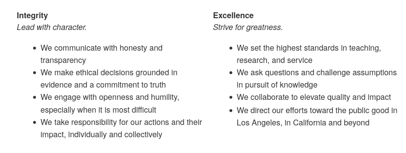

Universities are chock-full of "AI" these days.
From departments near and far, you can see academics describing their agentic workflows on bsky.app.
Everyone has never been so productive before, and no one produces slop, of course.

Snarky undertones aside, I'm always curious when smart people share their thoughts on technology since I study people's decision-making with AI. This is especially true for me when these people are far smarter and more successful than I am. 
However, I am quite often surprised by the guidelines that people come up with, which tend to leave me with an uneasy feeling.

It's not that I take issue with people having different opinions from my own. 
We are all learning about this technology as it unravels onto our societies[^1]. 
Where I find it eyebrow-raising is that the writings about AI I come across too often do not reflect on values, especially those that their employer (a university), and by extension, they themselves, purportedly subscribe to. Values can be a reliable tool for guiding one's decision-making in the face of uncertainty[^8].

[^8]: The [Magnifica Humanitas](https://www.vatican.va/content/leo-xiv/en/encyclicals/documents/20260515-magnifica-humanitas.html) is a good example of value-guided decision-making, in my opinion.

What I have realized from doing the research for this post, is that a lot of professor's lab policies describing how AI fits into academic work simply reflect the university's Academic Integrity policy, and leave out the  Aristotle/Kant/Humboldt/Newman ideals that shaped the values that are meant to guide universities and thus research.

So today, I decided I would reflect on the ideals of a university and think about what an AI policy really ought to look like if it was primarily guided by values, rather than liability minimization.

[^1]: though it is often surprising to me how relevant work from the 90's (sometimes even earlier) relates to problems de jour. 

# What is a university's mission?

Let's take a look at what universities typically stand for.

A university's mission is to *"create, disseminate, preserve, and apply knowledge"*. 
That's not some quote I just made up, it's straight from [UCLA's mission statement](https://www.ucla.edu/about/mission-and-values)[^2]. 

[^2]: My own university (UCI) does not seem to have a mission statement that is easily found on the web. I guess that means anything goes!

If we read a bit further, we learn that UCLA values, among other things, open access to information as well as excellence and quality in their pursuits. Some additional relevant keywords include:

- foundational knowledge
- scholarship
- in-depth study
- serving society
- teaching people skills

The bottom of the page links to [True Bruin values](https://www.ucla.edu/about/mission-and-values)
which expands on Integrity, Excellence, and Belonging[^3]. The first two concepts will be important for this post, here the screenshot:

Especially the last three points of the Integrity pledge stand out to me (emphasis mine):

- "We make **ethical** decisions grounded in evidence and a commitment to truth"
- "We engage with **openness** and humility, especially when it is most difficult"
- "We take **responsibility** for our actions and their impact, individually and collectively"

[^3]: To my surprise, the site features testimonials from academics at UCLA, but solely lacks one for the Integrity category. Does noone at UCLA endorse integrity in their work?

In summary, a university concerns itself with *knowledge*, and teaching people the *skills* to discover and disseminate it for themselves. Universities want to serve society by doing this in a way that is *ethical*, *accessible* to everyone, and puts *quality first*.

# Does current day AI use reflect university values? 

<!-- 'preserve' knowledge can be questioned; ethical, open is highly questionable -->

[^4]: When most people talk about "AI" these days, they usually mean "Large Language Models" (LLMs). I will be using the terms interchangeably here.

Many universities have been very keen on adopting AI[^4], for example, my university has created it's own flavor of chatbot, [ZotGPT](https://zotgpt.uci.edu/), which is themed after our anteater mascot.
I believe my university felt the need to do this to 1) create equal access to chatbots, and 2) to thereby have some say in how AI is used by students. It actually appears fairly well implemented to me, with the prompt library offering access to roles that aim to enrich learning rather than pump out essays. This emphasis on augmentation rather than production broadly aligns with my reading of papers about learning with AI, where commonly the finding is that LLMs can be harmful to learning when used for direct answers and automating the bulk of the work (historically called "cheating"), but can be helpful for allowing students to more readily engage with difficult concepts and further their understanding. 
While I may still have some concerns with the minutiae of when exactly the integration of AI presents a genuine improvement for learning outcomes, it appears that my university has an evidence-informed approach to integrating AI into the curriculum.

So maybe the kids will be okay, but what about the academics? It is well-known that the academic mindset is full of workaholist affirmations. You either publish or perish, and should feel no qualms working just a bit more in the evening, when sick, or on days off. When you are embedded in a work culture where you are **always** meant to be doing more and work even faster, it's self-evident that your use of AI is not going to stay healthy for long, even if you tell yourself you're only doing it because you love working *so* much. 

Of course, I understand that when an ambitious grad student or an over-worked professor fires up a vibe-coding tool they are not really all that concerned with whether this activity maximally serves their intellectual development, they are simply responding to the incentives of a fundamentally broken system that ultimately forces around 80% of PhD students to leave academia[^5].

[^5]: Given the scarcity of jobs, I believe academia is not a career you choose as much as it is a career that chooses you. If that is right, then maybe it's still a bit short-sighted to chase additional publications by any means neccessary *if* they come at the cost of your skill-development.

So does the reality of working in academia align with the values of a university? In my opinion, not really. For one, it seems to me that, by and large, the emphasis is on quantity more than it is on quality, going against the idea of striving for excellence. Of course, it's been like this before AI tools were popular, though their availability likely exacerbates these problems. 

In sum, AI tools can be beneficial to academia in principle, but they easily become problematic when they are used as crutches to keep up in a rat race. What would it take to ensure that AI reliably augments thought in line with university values?

# What could a value-aligned academic AI policy look like?

To be aligned with the foundational values of universities, an AI policy would have to set guidelines for using AI in a way that promotes the *ethical* pursuit of *excellence* and *knowledge*.

So let me try to address each of these keywords one by one.

The ethical use of AI would likely require open-source models (that is, where code, data and model-weights are openly available). These are currently pretty hard to come by[^6], perhaps because most training data is obtained without consent and via the exploitation of data workers in the global south. 

[^6]: Examples include the Allen Institute for AI's OLMo models, and Swiss AI's Apertus models.

It's clear that if ethically-sourced AI was a strict requirement, there would be relatively little use of LLMs today, because what's currently available in this domain is nowhere near the popular frontier models. Still, it should maybe give one pause to consider how far away one's AI assisted workflow is from the ethical frontier. I think it should be academia's goal to change habits towards what's possible with ethically-made AI[^7]. 

[^7]: Since ethical models are at least a year behind the frontier, this may naturally cushion against over-reliance on AI. 

Besides the ethical stuff, we would also have to consider how AI can promote human thought and thereby excellence and knowledge.
Increasingly, researchers are realizing that AI does not necessarily have to be about automating humans away, which is both hard and politically unpopular. Instead, it could be designed around helping people refine their work by augmenting human thought[^11].

[^11]: For an impression, check out this [website](https://www.microsoft.com/en-us/research/project/tools-for-thought/).

What does it mean for AI to augment people? Some of the uses that appear genuinely beneficial include:

- Rubber ducking
- Finding sources
- Finding errors
- Explaining difficult concepts
- Encouraging critical thinking

I think it's still very early days when it comes to designing software with AI as a tool to augment people. I would love to see tools that are designed around producing artifacts that help people reduce their future need for AI (thereby increasing their own competence). Where AI acts as scaffold or training wheels for human flourishing.

Either way, a value-aligned AI policy would likely have to clearly delineate where automating grunt-work is acceptable, and where AI can only serve to augment as to not undermine the organization's principles. Generally speaking, it appears the longer you can do your thing before reaching for AI assistance, the better, as you are then more likely to have used AI for augmentation[^10].

[^10]: The literature on Cognitive Forcing Functions is informative here in my opinion.

In conclusion, if my ramblings here are worth anything, then it seems one way to ensure that AI use is aligned with university values is by reducing the need to rush everything. If you don't have to rush out twenty thousand lines of code by using the latest frontier model then you can probably afford to integrate ethically made AI into your workflow to help you find useful packages. If you are not constantly rushing to have AI write your papers, you may even be able to afford to use this ethical AI to nudge you towards having a critical thought. Jokes aside, having the luxury to take one's time is more a structural than a technical constraint for academic work, though I think it is worthwhile to continue advocating for such change. 

